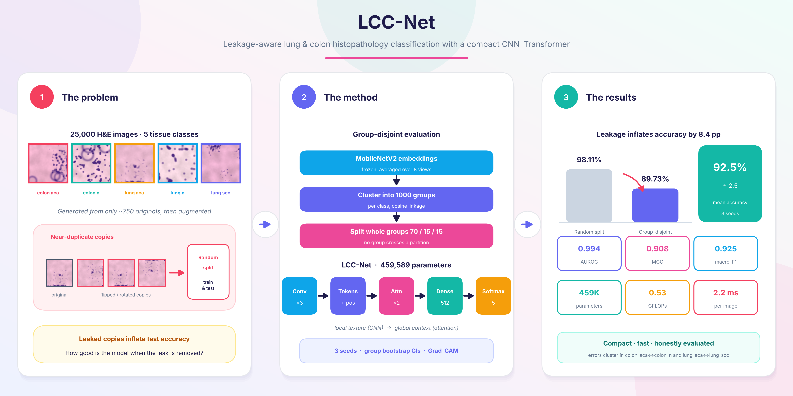
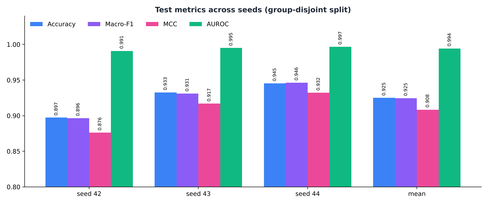
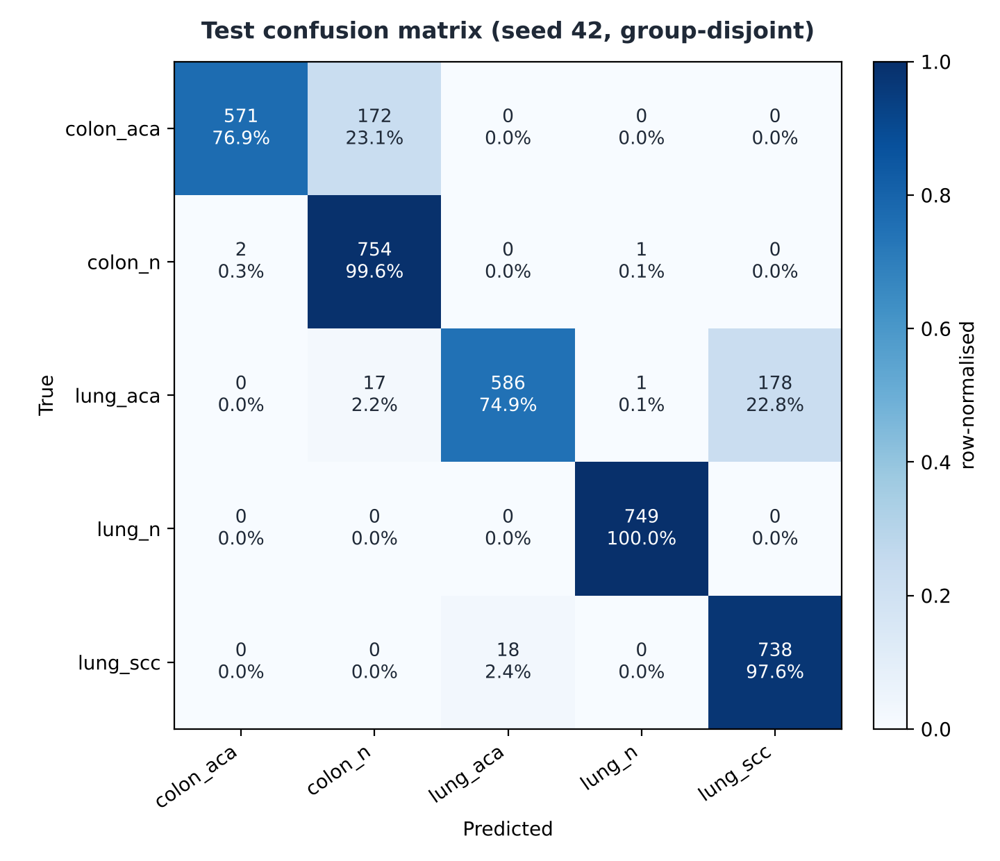
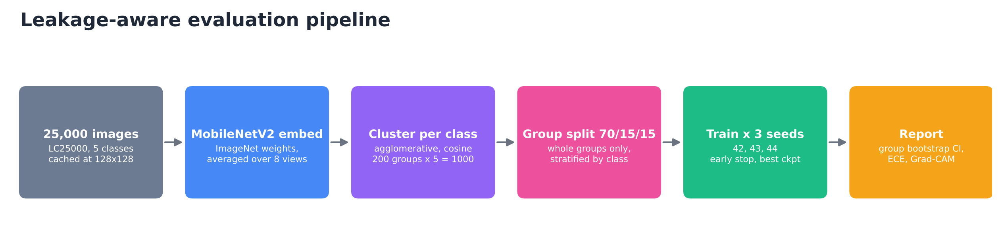
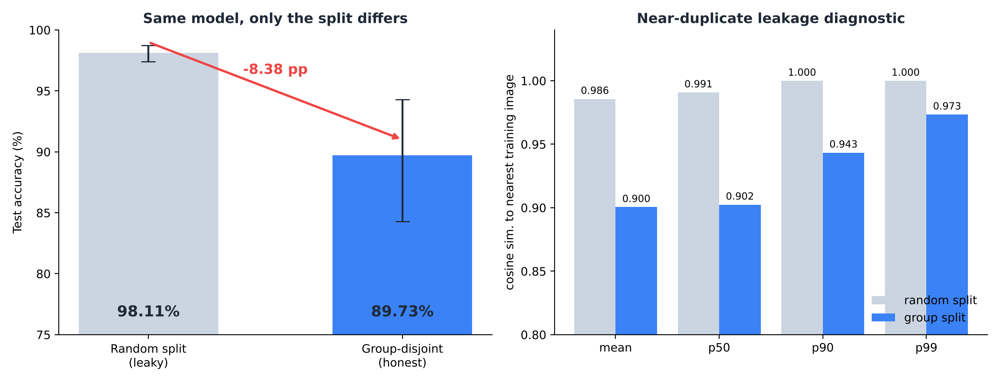
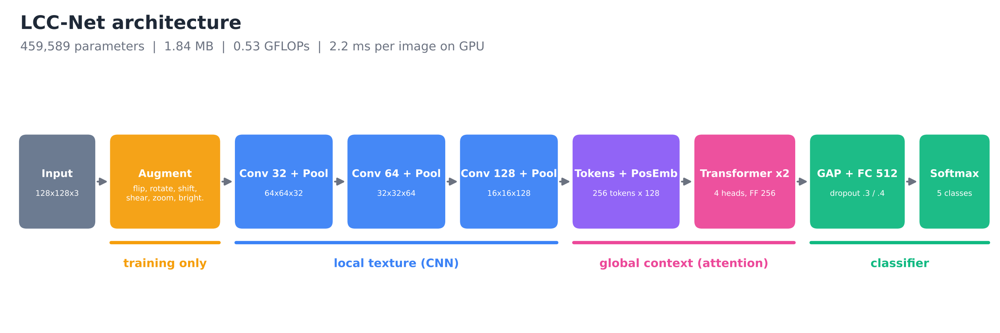
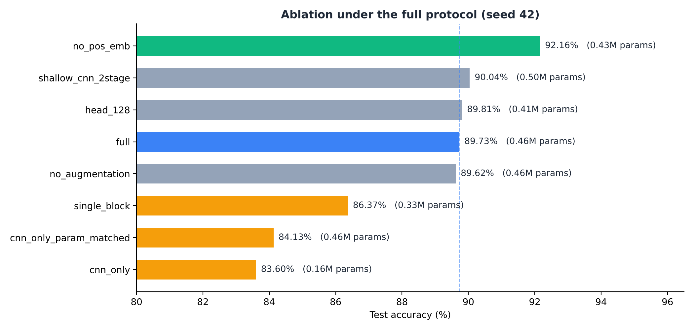
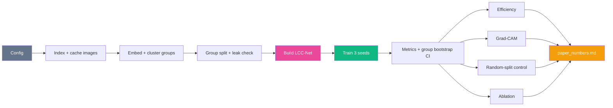

<div align="center">

# 🔬 LCC-Net

### A Leakage-Aware, Lightweight Attention-Based Deep Learning Framework for Explainable Multi-Organ Cancer Classification in Histopathology

**Pijush Kanti Roy Partho<sup>1</sup>, Tushar Emran<sup>1</sup>, Suchi Karmoker<sup>1</sup>, Dipraj Sarker<sup>2</sup>, Pankaj Bhowmik<sup>3</sup>, Md. Delowar Hossain<sup>3</sup>, Md Al Amin<sup>4</sup> and Tangina Sultana<sup>1,\*</sup>**

<sub>
<sup>1</sup> Department of Electronics and Communication Engineering, Hajee Mohammad Danesh Science and Technology University, Dinajpur, Bangladesh<br>
<sup>2</sup> Department of Statistics, Hajee Mohammad Danesh Science and Technology University, Dinajpur, Bangladesh<br>
<sup>3</sup> Department of Computer Science and Engineering, Hajee Mohammad Danesh Science and Technology University, Dinajpur, Bangladesh<br>
<sup>4</sup> Department of Informatics and Engineering Systems, College of Engineering and Computer Science, The University of Texas Rio Grande Valley (UTRGV), Brownsville, TX 78520 USA<br>
<sup>*</sup> Corresponding author
</sub>

<br>


<br>



</div>

---

## 📄 Abstract

Automated classification of lung and colon cancer subtypes from histopathological images is an important task in computational pathology, as accurate patch-level classification can support tissue analysis. Convolutional neural networks (CNNs), such as ResNet and VGG, effectively extract local morphological features but have limited capacity to capture long-range spatial dependencies. Although Transformer-based models address this limitation, they often require larger datasets and lack the inherent local feature extraction capabilities of convolutional layers.

To address these limitations, we propose **LCC-Net**, a lightweight CNN-Transformer attention model with **0.46 M parameters**, comprising a three-stage CNN stem and two multi-head self-attention blocks operating on a token grid enriched with learnable positional information. The model is trained using categorical cross-entropy and Adam optimization, with dropout, adaptive learning-rate scheduling, and early stopping. Grad-CAM and SHAP provide post-hoc explanations, while HDE-HistNet serves as a comparative ensemble.

Considering the augmentation-based construction of LC25000, we adopted **group-disjoint partitions** to prevent near-duplicate images from appearing across different subsets. Across three random seeds, LCC-Net achieved a mean test accuracy of **92.51% ± 2.49%**, macro-F1 of **0.9246 ± 0.0256**, and expected calibration error (ECE) of **0.0391 ± 0.0250**. An ablation study showed that removing the Transformer blocks reduced accuracy by approximately 5–6 percentage points, even at a matched parameter count. Five-fold cross-validation on the secondary HistoSet-5×14 dataset yielded 97.97% accuracy. A control and standard random-split accuracies (98.11% and 99.12%) further highlight the importance of leakage-controlled evaluation.

Although Grad-CAM and SHAP provided post-hoc explanations, these outputs were not validated by pathologists. Overall, LCC-Net demonstrates potential for lightweight patch-level histopathological image classification under group-disjoint evaluation. However, patient-level generalization, clinical validity, and diagnostic performance have not been established.

**Keywords:** `Deep Learning` · `Attention Mechanism` · `Lung and Colon Cancer` · `Machine Learning` · `Decision Support System` · `Healthcare`

> 📓 **About this repository:** the notebook reproduces the LC25000 group-disjoint experiments (main results, random-split control, ablation, efficiency, Grad-CAM). The SHAP analysis, the HDE-HistNet ensemble and the HistoSet-5×14 cross-validation reported in the abstract are part of the paper and are **not** produced by this notebook.

---

## ✨ Highlights

| | |
|---|---|
| 🧠 **Tiny hybrid model** | 3 conv stages for local texture + 2 Transformer blocks for global context, only **459,589 parameters (1.84 MB)** |
| ⚡ **Fast** | **0.53 GFLOPs**, **2.21 ms** per image (batch 1) and **~2,820 img/s** (batch 32) on a GPU |
| 🛡️ **Leakage-aware evaluation** | LC25000 is built from ~250 originals per class that were augmented. Near-duplicates are clustered into groups so a group is never split across train/val/test |
| 📏 **Honest statistics** | 3 seeds, **group bootstrap** 95% CIs, ECE calibration, MCC, κ, AUROC/AUPRC |
| 🔍 **Explainable** | Grad-CAM at both the conv stage (`pool3`) and the last Transformer block (`tb2_drop`). Explanations are post-hoc and **not validated by pathologists** |
| ♻️ **Resumable** | Every run is saved as JSON. If Colab disconnects, re-run the notebook and finished runs are skipped |

---

## 📊 Results

Group-disjoint split (70/15/15), 3 seeds, test set (~3.7K images per seed).

| Metric | Seed 42 | Seed 43 | Seed 44 | **Mean ± SD** |
|---|:---:|:---:|:---:|:---:|
| Accuracy | 0.8973 | 0.9327 | 0.9453 | **0.9251 ± 0.0249** |
| Macro-F1 | 0.8964 | 0.9310 | 0.9464 | **0.9246 ± 0.0256** |
| MCC | 0.8762 | 0.9169 | 0.9322 | **0.9084 ± 0.0289** |
| Cohen's κ | 0.8716 | 0.9158 | 0.9316 | **0.9063 ± 0.0311** |
| Balanced acc. | 0.8980 | 0.9310 | 0.9481 | **0.9257 ± 0.0255** |
| AUROC (macro) | 0.9909 | 0.9951 | 0.9968 | **0.9943 ± 0.0031** |
| AUPRC (macro) | 0.9681 | 0.9842 | 0.9882 | **0.9801 ± 0.0106** |
| ECE ↓ | 0.0670 | 0.0318 | 0.0186 | **0.0391 ± 0.0250** |

<div align="center">

</div>

> The 95% group-bootstrap CI for seed 42 accuracy is **[0.8427, 0.9429]**. It is wide because errors are concentrated: in seed 42, 24 of 138 test groups hold all 389 errors, and the top 10 groups account for 76% of them.

### Other numbers reported in the paper

| Experiment | Accuracy | Where |
|---|:---:|---|
| LC25000, group-disjoint (3 seeds, mean ± SD) | 92.51% ± 2.49% | this notebook |
| LC25000, control random split (seed 42) | 98.11% | this notebook |
| LC25000, standard random split | 99.12% | paper |
| HistoSet-5×14, five-fold cross-validation | 97.97% | paper |

### Per-class performance (seed 42)

| Class | Sensitivity | Specificity | AUROC | AUPRC |
|---|:---:|:---:|:---:|:---:|
| colon_aca | 0.7685 | 0.9993 | 0.9959 | 0.9856 |
| colon_n | 0.9960 | 0.9376 | 0.9970 | 0.9880 |
| lung_aca | 0.7494 | 0.9940 | 0.9778 | 0.9362 |
| lung_n | 1.0000 | 0.9993 | 1.0000 | 1.0000 |
| lung_scc | 0.9762 | 0.9413 | 0.9837 | 0.9305 |

<div align="center">

</div>

The errors are structured rather than random. Most of them are **colon adenocarcinoma → benign colon** (172) and **lung adenocarcinoma → lung SCC** (178). **Normal lung** is classified perfectly.

---

## 🛡️ Why the evaluation is different

LC25000 contains 25,000 images generated by augmenting ~750 original slides, so a naive random split puts near-identical images on both sides of the train/test boundary. This repo measures that effect directly.

<div align="center">

</div>

1. **Embed** every image with a frozen ImageNet MobileNetV2, averaged over 8 flip/rotation views so rotated copies land close together.
2. **Cluster** within each class (agglomerative, cosine, average linkage) into 200 groups per class (1000 total; median 18 images per group).
3. **Split** whole groups into train/val/test, class by class, with an assertion that no group crosses a partition.
4. **Diagnose** leakage by measuring each test image's cosine similarity to its nearest training image.
5. **Control** by training the identical model on a naive random split.

<div align="center">

</div>

| Split | Test accuracy | 95% CI | Nearest-train similarity (mean) |
|---|:---:|:---:|:---:|
| Random (control) | 98.11% | [97.42, 98.74] | 0.9857 |
| **Group-disjoint** | **89.73%** | [84.27, 94.29] | **0.9005** |

**A random split inflates accuracy by 8.38 percentage points** with the same model and recipe. Note the groups are a proxy, since LC25000's source IDs are not published. Residual leakage is reduced but not provably zero (p99 similarity is still 0.973).

---

## 🏗️ Model

<div align="center">

</div>

```
Input 128×128×3 (0–255)
 └─ Augmentation (training only): flip · rotate ±15° · shift 10% · shear · zoom ±20% · brightness
 └─ Rescaling 1/255
 └─ Conv3×3(32)  + MaxPool   → 64×64×32
 └─ Conv3×3(64)  + MaxPool   → 32×32×64
 └─ Conv3×3(128) + MaxPool   → 16×16×128
 └─ Reshape to 256 tokens × 128 dims + learned positional embedding
 └─ 2 × Transformer block  (MHSA 4 heads, key_dim 32 → residual+LN → FFN 256 → residual+LN → dropout .1)
 └─ GlobalAveragePooling → Dropout .3 → Dense 512 → Dropout .4 → Dense 5 (softmax)
```

Augmentation lives *inside* the model and is active only during training, so validation, test, latency and Grad-CAM all see clean images.

### Efficiency

| Params | Size (fp32) | GMACs | GFLOPs | Latency (bs=1) | Latency (bs=32) | Throughput |
|:---:|:---:|:---:|:---:|:---:|:---:|:---:|
| 459,589 | 1.84 MB | 0.266 | 0.532 | 2.21 ± 0.44 ms (p95 2.40) | 11.35 ms | 2,820 img/s |

FLOPs are counted analytically (2 × MACs) and include the attention matrix products that some profilers skip.

### Training recipe

| Setting | Value |
|---|---|
| Optimizer | Adam, lr `1e-4` |
| Schedule | `ReduceLROnPlateau` (×0.3, patience 3) |
| Epochs | up to 50, early stopping on `val_loss` (patience 10), best checkpoint restored |
| Batch size | 32 |
| Loss | sparse categorical cross-entropy |
| Precision | float32 (mixed precision optional) |
| Seeds | 42, 43, 44 |

---

## 🧪 Ablation (full protocol, seed 42)

Every variant uses the same split, seed, 50-epoch budget and early stopping.

<div align="center">

</div>

| Variant | Params (M) | Test acc | Δ vs full (pp) | Macro-F1 | MCC |
|---|:---:|:---:|:---:|:---:|:---:|
| `full` | 0.4596 | 0.8973 | 0.00 | 0.8964 | 0.8762 |
| `no_pos_emb` | 0.4268 | 0.9216 | +2.43 | 0.9217 | 0.9033 |
| `cnn_only` | 0.1619 | 0.8360 | −6.13 | 0.8322 | 0.8031 |
| `cnn_only_param_matched` | 0.4570 | 0.8413 | −5.60 | 0.8367 | 0.8129 |
| `single_block` | 0.3271 | 0.8637 | −3.35 | 0.8606 | 0.8379 |
| `shallow_cnn_2stage` | 0.5025 | 0.9004 | +0.32 | 0.8992 | 0.8813 |
| `no_augmentation` | 0.4596 | 0.8962 | −0.11 | 0.8955 | 0.8765 |
| `head_128` | 0.4081 | 0.8981 | +0.08 | 0.8963 | 0.8793 |

**Reading the table honestly**

- ✅ **Attention helps.** Removing the Transformer blocks costs ~6 pp, and the parameter-matched CNN (extra convs instead of attention) is still 5.6 pp worse, so the gain is not just extra capacity. Dropping to one block loses 3.35 pp.
- ⚠️ **Positional embedding did not help here.** `no_pos_emb` scored +2.43 pp *higher* than the full model. With a single seed and a seed-to-seed SD of ~2.5 pp (see above), this is within noise, but it is worth re-testing across seeds before claiming the embedding is beneficial.
- ⚠️ Augmentation, the 128-d head and the 2-stage CNN all fall within ±0.3 pp, i.e. not distinguishable from the full model on one seed.

---

## 🚀 Quick start

### 1. Install

```bash
pip install tensorflow numpy pandas matplotlib pillow scikit-learn
```

### 2. Get the data

Download [LC25000](https://www.kaggle.com/datasets/andrewmvd/lung-and-colon-cancer-histopathological-images) and keep the zip so it extracts to:

```
lung_colon_image_set/
├── colon_aca/    colon_n/
└── lung_aca/     lung_n/     lung_scc/
```

### 3. Configure and run

Open `LCC_NET_v3.ipynb` (made for Google Colab + GPU) and edit the `CFG` cell:

```python
CFG = dict(
    ZIP_PATH = '/content/drive/MyDrive/lung/dataset/lung_colon_image_set.zip',
    DATA_DIR = '/content/lung_colon_image_set',
    OUT_DIR  = '/content/drive/MyDrive/lung/lccnet_v2',
    IMG=128, BATCH=32, EPOCHS=50, LR=1e-4, PATIENCE=10,
    SEEDS=[42, 43, 44],
    GROUPS_PER_CLASS=200,
    RUN_RANDOM_SPLIT_CONTROL=True,   # 1 extra run
    RUN_ABLATION=True,               # 8 runs, resumable
)
```

Then **Runtime → Run all**.

> Set `RUN_ABLATION=False` for a faster run, and `MIXED_PRECISION=True` for speed (report it if you do).

---

## 📁 Outputs

Everything worth keeping is written to `OUT_DIR`:

```
lccnet_v2/
├── index.csv · images_128.npy · embeddings_mnv2_128.npy   # caches
├── groups.csv                                             # near-duplicate group per image
├── runs/
│   ├── split_group_seed{42,43,44}.csv                     # exact train/val/test partitions
│   ├── main_seed*.json                                    # metrics, CIs, history
│   ├── main_seed*_testpreds.npz                           # test probabilities (for McNemar etc.)
│   ├── main_seed*.weights.h5                              # best checkpoints
│   └── efficiency.json
├── plots/                                                 # curves, ROC/PR, confusion, Grad-CAM
├── ablation_full_protocol.csv
└── paper_numbers.md                                       # every number the paper needs
```

> 🔁 **Fair baselines:** reuse `split_group_seed*.csv` for ResNet, VGG, DNN, HDE-HistNet and others so every model sees the same data.

---

## 🧭 Notebook map



---

## ⚠️ Limitations

- This is **patch-level** classification. **Patient-level generalization, clinical validity and diagnostic performance have not been established.**
- Grad-CAM and SHAP outputs are post-hoc explanations and were **not validated by pathologists**.
- LC25000 is a single-source, augmentation-heavy dataset. Group-disjoint results are more realistic than random splits, but external validation on independent slides and sites is still needed.
- Groups are a clustering proxy because LC25000's source IDs are not published, so some leakage may remain.
- Seed-to-seed variance is large (accuracy 89.7% to 94.5%), so report means ± SD, not a single run.
- The ablation uses one seed, and the no-positional-embedding variant scored higher than the full model in that run.
- For research use only. This is not a medical device.

---

## 📝 Citation

```bibtex
@article{partho_lccnet,
  title   = {LCC-Net: A Leakage-Aware, Lightweight Attention-Based Deep Learning Framework
             for Explainable Multi-Organ Cancer Classification in Histopathology},
  author  = {Partho, Pijush Kanti Roy and Emran, Tushar and Karmoker, Suchi and Sarker, Dipraj and
             Bhowmik, Pankaj and Hossain, Md. Delowar and Amin, Md Al and Sultana, Tangina},
  year    = {2026},
  journal = {<journal>}
}
```

📬 **Correspondence:** Tangina Sultana, Department of Electronics and Communication Engineering, and Pankaj Bhowmik, Department of Computer Science and Engineering, Hajee Mohammad Danesh Science and Technology University, Dinajpur, Bangladesh.

---

<div align="center">

**If this helps your research, consider giving it a ⭐**

</div>
